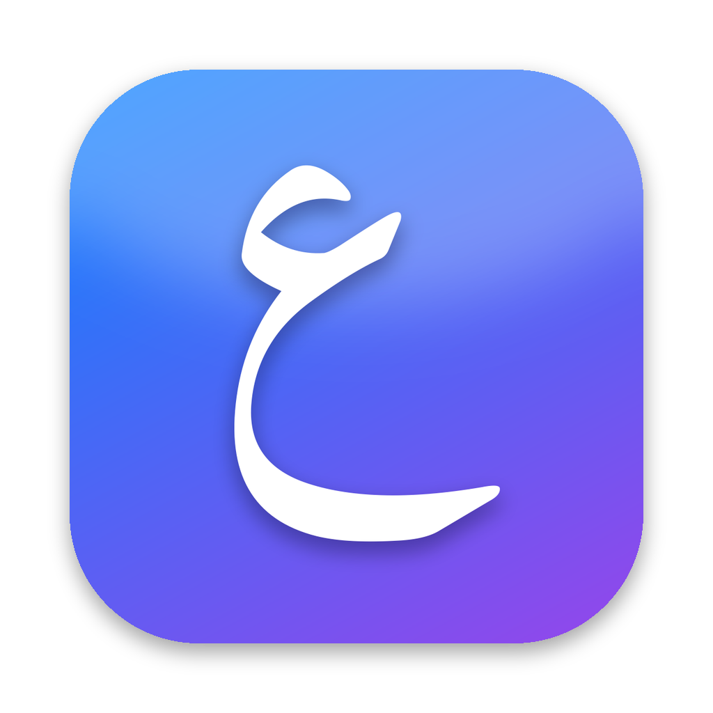

<div align="center">



# Arab Writer

**محرّك كتابة ومستندات عربي على الماك، بواجهة زجاج أبل.**

يمسح بصمات الذكاء الاصطناعي من النص، يدقق الإملاء والنحو والترقيم، ويتحكم في ملفات وورد وإكسل و PDF.

</div>

---

## ماذا يسوي

| القسم | الوظيفة | يحتاج مفتاح Claude؟ |
|---|---|---|
| الكتابة | إعادة صياغة بصوت بشري، تدقيق، كتابة من فكرة، قالب المنصة، قفل الطول، عرض التغييرات | نعم (بدونه: إصلاح آلي فقط) |
| الفاحص | فحص فوري أثناء الكتابة: بصمات آلية، إملاء، ترقيم، نحو نمطي، إيقاع، معلومات مضافة | لا |
| القصة | قصة قصيرة من عنوان، تُحفظ PDF | نعم |
| وورد | تدقيق آمن يبقي التنسيق، بحث واستبدال، اتجاه عربي، حفظ docx و PDF | لا (الصياغة الذكية: نعم) |
| إكسل | فتح xlsx و csv، تعديل الخلايا، ترتيب، جمع ومتوسط، ضرب وقسمة، تنظيف، حذف المكرر | لا |
| PDF | دمج، تقسيم، استخراج وحذف وترتيب صفحات، علامة مائية عربية، ترقيم، حماية، ضغط، تحويل صور، استخراج النص | لا |
| PDF | تلخيص عربي بإخراج PDF مرتب مع شعارك | نعم |

## التثبيت

1. حمّل آخر إصدار من صفحة
[Releases](../../releases)
2. افتح ملف
`dmg`
واسحب التطبيق إلى مجلد التطبيقات.
3. أول مرة: كليك يمين على التطبيق ثم «فتح».

يتطلب
macOS 26
أو أحدث.

## مفتاح Claude

المزايا الذكية تشتغل بمفتاحك الخاص من
[Anthropic Console](https://console.anthropic.com/settings/keys).
حطه من الإعدادات
(⌘ ,).
المفتاح يُحفظ في سلسلة مفاتيح الماك على جهازك فقط، ويُرسل مباشرة إلى
Anthropic.

## البناء من المصدر

```bash
swift test                        # اختبارات محرك الفحص
swift run ArabWriter              # تشغيل مباشر
scripts/build_app.sh 1.0.0        # Arab Writer.app + zip + dmg في dist/
```

يحتاج
Xcode 26.

كل دفعة إلى
`main`
تُبنى تلقائياً، وكل وسم
`v*`
ينشر إصداراً جاهزاً للتحميل.

## مبني على

مهارة
[Arab Writer](https://github.com/turky015-oss/Arab-Writer)
لـ
Claude.
الخط: أميري
(SIL Open Font License).

---

<div align="center">تركي السلطان · Ksa8Turky</div>
