<div dir="rtl" align="right">

<div align="center">


# Arab Writer

**محرّك كتابة ومستندات عربي على الماك، بواجهة زجاج أبل**

يمسح بصمات الذكاء الاصطناعي من النص، ويدقق الإملاء والترقيم، ويترجم بصوت بشري، ويجهّز سكربت الفيديو، ويتحكم في ملفات وورد وإكسل و PDF.

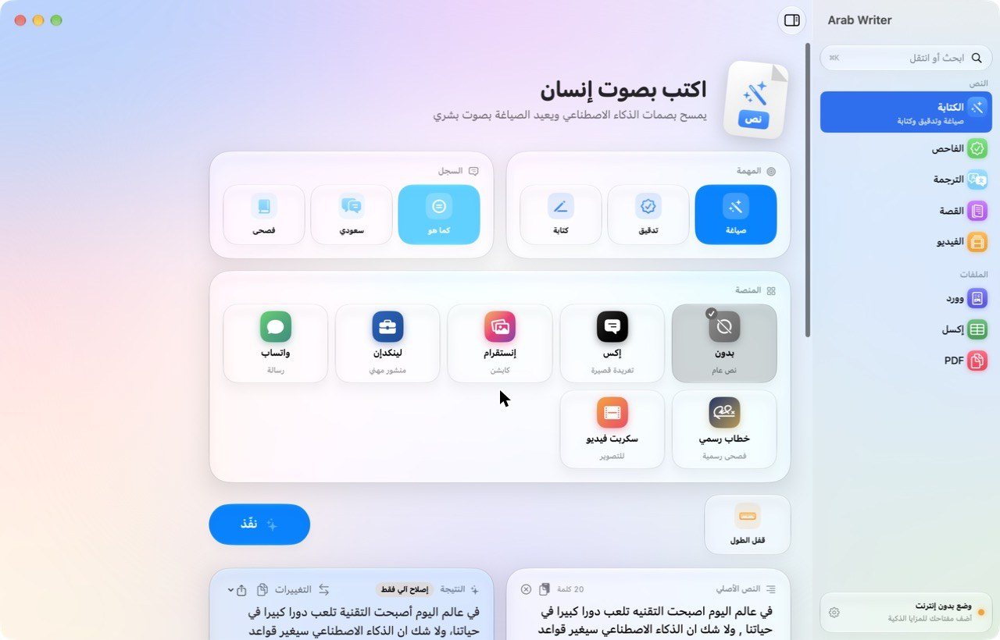

</div>

---

## المحتويات

- [التثبيت](#التثبيت)
- [أول تشغيل: مفتاح Claude](#أول-تشغيل-مفتاح-claude)
- [الأقسام](#الأقسام)
- [دقّق من أي برنامج](#دقّق-من-أي-برنامج)
- [الفحص السريع من شريط القوائم](#الفحص-السريع-من-شريط-القوائم)
- [الاختصارات](#الاختصارات)
- [الخصوصية](#الخصوصية)
- [البناء من المصدر](#البناء-من-المصدر)

---

## التثبيت

1. حمّل ملف التثبيت من صفحة [الإصدارات](../../releases).
2. افتح الملف واسحب **Arab Writer** إلى مجلد التطبيقات.
3. أول فتح: النظام يمنع البرامج غير الموقّعة من متجر أبل. افتح البرنامج مرة، ثم روح:
   **الإعدادات ← الخصوصية والأمان** وانزل تحت واضغط **«فتح على أي حال»**.

إذا ظهرت رسالة أن البرنامج «تالف»، افتح تطبيق الطرفية والصق هذا السطر:

```
xattr -dr com.apple.quarantine "/Applications/Arab Writer.app"
```

**المتطلبات:** نظام ماك 26 أو أحدث، ويشتغل على معالجات أبل وإنتل.

---

## أول تشغيل: مفتاح Claude

البرنامج يشتغل في وضعين:

| الوضع | وش يشتغل |
|---|---|
| **بدون إنترنت** | الفاحص، الإصلاح الآلي للإملاء والترقيم، أدوات وورد وإكسل و PDF، والقراءة الضوئية |
| **مع مفتاح Claude** | كل ما سبق، وإعادة الصياغة، والكتابة من فكرة، والترجمة، والقصة، والفيديو، والتلخيص الذكي |

لتفعيل المزايا الذكية:

1. أنشئ مفتاحاً من [لوحة Anthropic](https://console.anthropic.com/settings/keys).
2. افتح إعدادات البرنامج بالضغط على **⌘ ,** أو من الزر أسفل الشريط الجانبي.
3. الصق المفتاح واضغط **حفظ**.

النقطة أسفل الشريط الجانبي تتحول من البرتقالي إلى الأخضر لما يتفعّل المفتاح. ومن الإعدادات نفسها تختار النموذج: الأدق، أو المتوازن، أو الأسرع.

---

## الأقسام

### الكتابة


القسم الرئيسي. تختار ثلاثة أشياء ثم تضغط **نفّذ**:

- **المهمة:** صياغة (يمسح البصمات ويعيد الكتابة بصوت بشري)، تدقيق (يصحح اللغة فقط ويبقي كلامك كما هو)، أو كتابة (من فكرة خام إلى نص جاهز).
- **السجل:** كما هو، سعودي، أو فصحى.
- **المنصة:** إكس، إنستقرام، لينكدإن، واتساب، خطاب رسمي، سكربت فيديو. كل منصة لها قالبها.

ومعها **قفل الطول**: تحدد عدد الكلمات والنص يطلع في حدوده بهامش عشرة بالمئة.

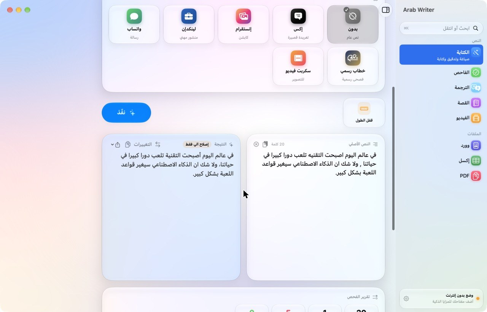

النتيجة تطلع بجانب الأصل، ومع المفتاح تنكتب قدامك كلمة كلمة. فوقها أزرار:

- **التغييرات:** يعرض كل كلمة تغيرت عن الأصل، المحذوف بالأحمر والجديد بالأخضر، مع نسبة التشابه.
- **نسخ.**
- **حفظ:** وورد، أو PDF بخط عربي، أو نص عادي.

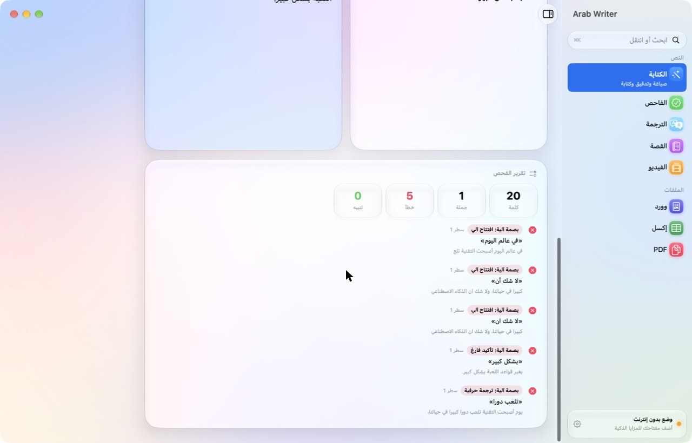

تحت النتيجة **تقرير الفحص**: عدد الكلمات والجمل والأخطاء والتنبيهات، وكل خطأ بنوعه ورقم سطره والجملة اللي فيها.

### الفاحص

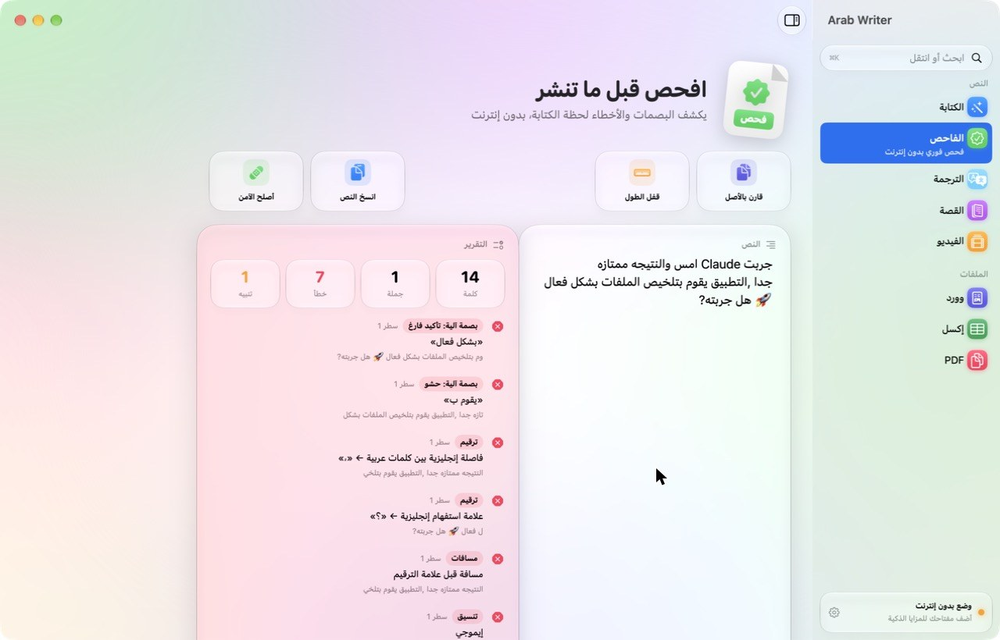

يفحص النص وأنت تكتب، بدون إنترنت. يكشف:

| الفحص | أمثلة |
|---|---|
| بصمات الذكاء الاصطناعي | «في عالم اليوم»، «لا شك أن»، «يلعب دوراً»، «بشكل فعّال» |
| الإملاء | الهمزات، التاء المربوطة، الألف المقصورة، وأكثر من ١٥٠ خطأ شائع |
| الترقيم | الفاصلة وعلامة الاستفهام الإنجليزية، والمسافات قبل العلامات |
| الاتجاه | الكلمة الإنجليزية داخل سطر عربي |
| الإيقاع | جمل متتالية بطول متشابه، والتقطيع الدرامي |
| الاختلاق | أي رقم أو اسم ما هو موجود في الأصل (فعّل «قارن بالأصل») |

زر **أصلح الآمن** يصحح كل ما يمكن تصحيحه آلياً بضغطة: الإملاء والترقيم والمسافات والإيموجي.

### الترجمة

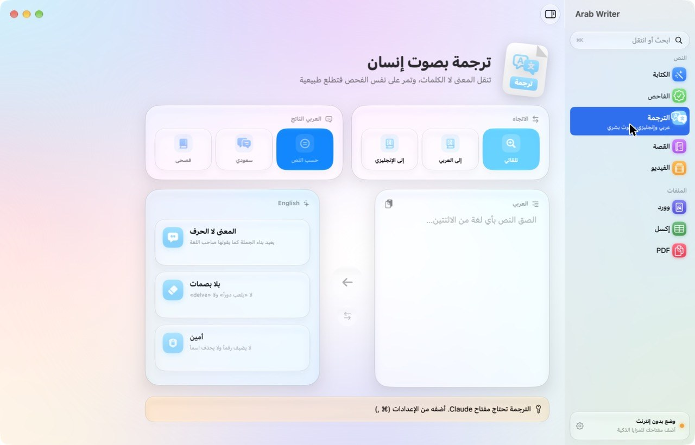

ترجمة بين العربي والإنجليزي تنقل المعنى لا الكلمات.

- **الاتجاه:** تلقائي (يعرف لغة النص بنفسه)، إلى العربي، أو إلى الإنجليزي.
- **العربي الناتج:** حسب النص، سعودي، أو فصحى.
- الترجمة العربية تمر على الفاحص، فينكشف أي رقم أو اسم مضاف.
- زر التبديل في الوسط يقلب الاتجاه ويحط الترجمة مكان الأصل.

### القصة

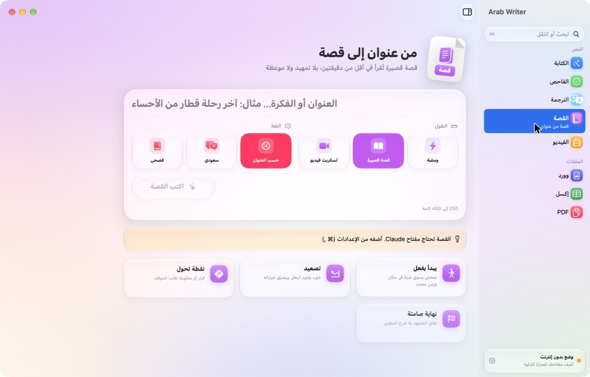

تكتب عنواناً أو فكرة، وتختار الطول (ومضة، قصة قصيرة، لسكربت فيديو) واللغة، ويطلع لك قصة تبدأ بفعل وتنتهي بلا موعظة. تقدر تحفظها PDF.

### الفيديو

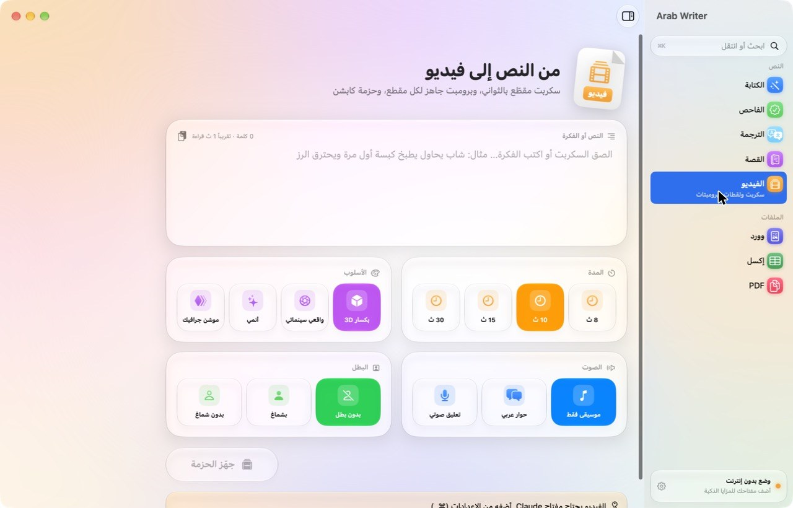

يحوّل النص أو الفكرة إلى حزمة جاهزة لنماذج توليد الفيديو. تختار المدة والأسلوب والصوت والبطل، ويطلع لك:

1. **خط زمني ملوّن:** كل لقطة بعرض ثوانيها، ومجموعها يساوي المدة بالضبط.
2. **النص النظيف** بعد مسح البصمات.
3. **النموذج المقترح** وسبب اختياره.
4. **برومبت لكل مقطع** بالإنجليزية، مع زر نسخ.
5. **حزمة الكابشن:** الخطاف، وسطور الشاشة بتوقيتها، وكابشن النشر، والوسوم.

زر **انسخ الحزمة** ينسخ كل شيء مرة وحدة.

### وورد

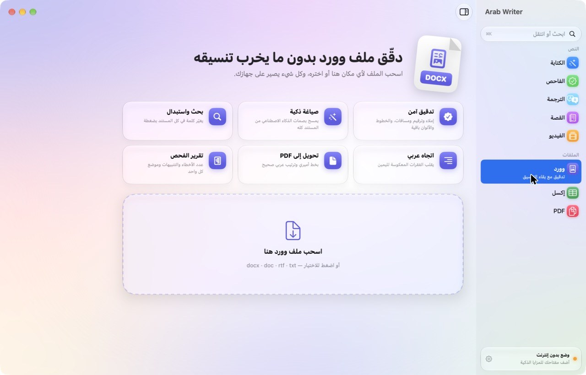

اسحب ملف وورد أو اختره، وبعدها:

- **تدقيق آمن:** يصحح الإملاء والترقيم والمسافات، والخطوط والألوان والجداول باقية كما هي.
- **صياغة ذكية:** يعيد كتابة المستند كله بدون بصمات (احفظه بنسخة جديدة ليبقى الأصل).
- **اتجاه عربي:** يقلب الفقرات المعكوسة لليمين.
- **بحث واستبدال** في كل المستند.
- **حفظ** وورد أو PDF أو نص.

### إكسل

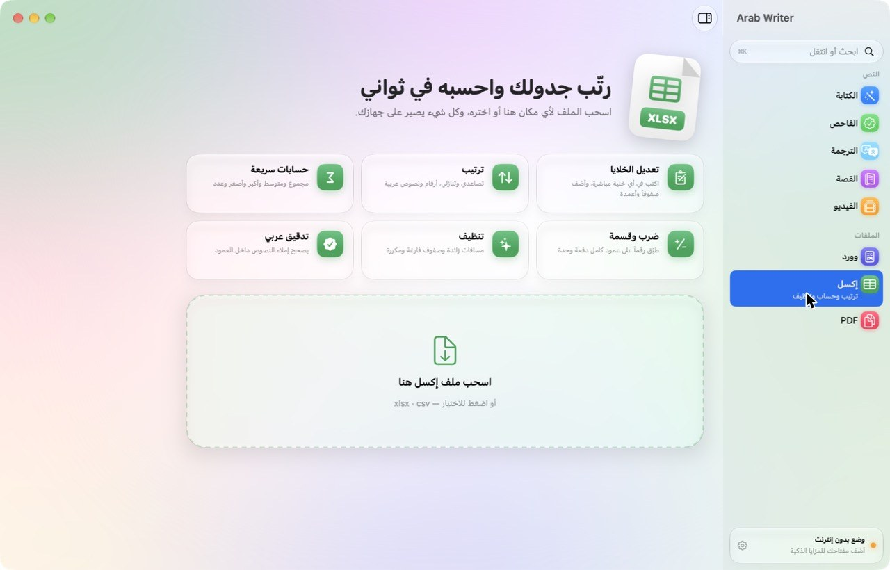

يفتح ملفات xlsx و csv، وتقدر:

- تعدّل أي خلية مباشرة، وتضيف صفوفاً وأعمدة.
- ترتب تصاعدياً أو تنازلياً حسب أي عمود.
- تحسب المجموع والمتوسط والأكبر والأصغر والعدد.
- تضرب أو تقسم أو تجمع أو تطرح رقماً على عمود كامل.
- تنظّف المسافات الزائدة والصفوف الفارغة والمكررة.
- تدقق إملاء النصوص العربية داخل العمود.

الملف المحفوظ يفتح في إكسل من اليمين لليسار، والصف الأول عريض.

### PDF

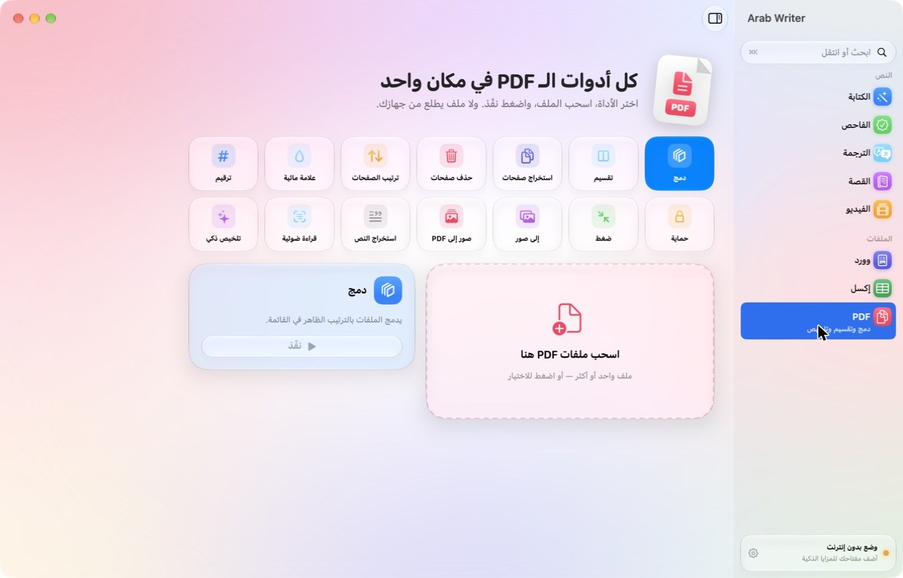

أربع عشرة أداة، كلها على جهازك:

| الأداة | وش تسوي |
|---|---|
| دمج | يجمع عدة ملفات بالترتيب اللي تحدده |
| تقسيم | كل صفحة في ملف مستقل |
| استخراج صفحات | مثل: ١-٣، ٥ |
| حذف صفحات | يحذف ويحفظ نسخة جديدة |
| ترتيب الصفحات | تكتب الترتيب الجديد |
| علامة مائية | نص عربي شفاف بالمائل على كل صفحة |
| ترقيم | بالأرقام العربية أو الإنجليزية أو «١ من ١٠» |
| حماية | كلمة مرور عند الفتح |
| ضغط | يصغّر حجم الصور داخل الملف |
| إلى صور | كل صفحة صورة بدقة عالية |
| صور إلى PDF | يجمع الصور في ملف واحد |
| استخراج النص | ولو كان الملف ممسوحاً يقرؤه تلقائياً |
| قراءة ضوئية | يقرأ العربي والإنجليزي من الصور والملفات الممسوحة |
| تلخيص ذكي | ملخص عربي يُحفظ PDF مرتب، مع شعارك إن أضفته |

---

## دقّق من أي برنامج

ظلّل أي نص في أي برنامج (واتساب، المتصفح، الملاحظات، البريد)، ثم **كليك يمين ← الخدمات**، وتلقى:

| الخدمة | وش تسوي |
|---|---|
| **صحّح الإملاء والترقيم** | فوري وبدون إنترنت، والنص يتبدل مكانه |
| **أعد الصياغة بصوت بشري** | بـ Claude، ويرجع النص مكانه بعد ثوانٍ |
| **افتح النص في البرنامج** | ينقله لقسم الكتابة |

الخدمات تظهر بعد ما تحط البرنامج في مجلد التطبيقات وتشغّله مرة. إذا ما ظهرت، فعّلها من:
**الإعدادات ← لوحة المفاتيح ← اختصارات لوحة المفاتيح ← الخدمات ← النص**. ومن نفس المكان تعطيها اختصاراً.

---

## الفحص السريع من شريط القوائم

أيقونة صغيرة فوق جنب الساعة، تفتح نافذة فيها مربع نص وعدّاد الأخطاء وأهم الملاحظات، مع أزرار: لصق، صحّح، صغ، انسخ. والبرنامج يبقى شغالاً فيها حتى لو قفلت النافذة الرئيسية. تقدر تخفيها من الإعدادات.

---

## الاختصارات

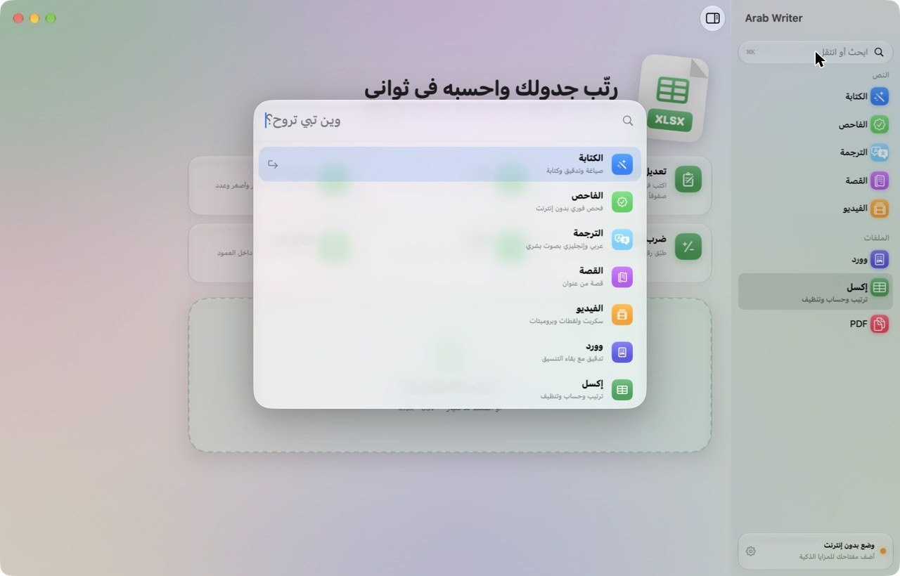

| الاختصار | وش يسوي |
|---|---|
| **⌘ K** | لوحة الأوامر: اكتب اسم القسم وانتقل بالأسهم و Return |
| **⌘ 1** إلى **⌘ 8** | الأقسام بالترتيب: الكتابة، الفاحص، الترجمة، القصة، الفيديو، وورد، إكسل، PDF |
| **⌘ Return** | نفّذ في القسم الحالي |
| **⌘ ,** | الإعدادات |

---

## الخصوصية

- الفاحص وأدوات الملفات والقراءة الضوئية تشتغل على جهازك بالكامل، ولا ملف يطلع منه.
- المزايا الذكية ترسل النص فقط إلى Anthropic مباشرة بمفتاحك، بدون أي خادم وسيط.
- المفتاح محفوظ في سلسلة مفاتيح الماك، لا في ملف ولا في الإعدادات.
- أصوات الواجهة من أصوات النظام، وتقفلها من الإعدادات.

---

## البناء من المصدر

يحتاج Xcode 26.

```bash
swift test                        # اختبارات محرك الفحص
swift run ArabWriter              # تشغيل مباشر
scripts/build_app.sh 1.0.0        # ينشئ التطبيق وملفات التثبيت في dist
```

كل تحديث على الفرع الرئيسي يُبنى ويُختبر تلقائياً، وكل وسم يبدأ بـ v ينشر إصداراً جاهزاً للتحميل.

**هيكل المشروع**

| المجلد | المحتوى |
|---|---|
| `Sources/ArabWriterCore` | محرك الفحص والإصلاح والفرق بين النصين، بلا واجهة |
| `Sources/ArabWriter/Services` | الاتصال بـ Claude، ووورد، وإكسل، و PDF، والقراءة الضوئية، وخدمات النظام |
| `Sources/ArabWriter/Views` | الواجهة والمكونات الزجاجية |
| `Sources/ArabWriter/Resources` | تعليمات المهارة والخط |
| `Tests` | اختبارات المحرك |

---

## مبني على

مهارة [Arab Writer](https://github.com/turky015-oss/Arab-Writer) لـ Claude، بنفس قواعدها وقوائمها.
الخط: أميري، برخصة الخطوط المفتوحة.

<div align="center">

**تركي السلطان · Ksa8Turky**

</div>

</div>
